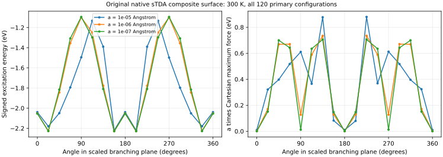

# Native sTDA: local topology of the stalled frontier seam

The ethylene follow-up keeps the original signed `F_GFN1 + Omega_sTDA`, state zero,
300 K and the original fitted parameters. It neither replaces the surface by
an envelope nor imposes a planar or electronic-gap optimization constraint.
The earlier unconstrained force-zero points remain classified as saddles;
see [the original results](stda-pes.md).

## Shrinking-neighborhood calculation

The final unshifted frontier gap has strongly different first-order
sensitivities in the two measured branching directions: approximately
`1433.94` and `6.99531 eV/angstrom`, a ratio of about 205. A coarse uniform
nuclear circle can miss the narrow angular feature. We therefore also sample
ellipses that equalize those first-order electronic gap sensitivities:

```text
R(a, theta) = R_seam + a cos(theta) v0 + a (s0/s1) sin(theta) v1
```

`v0/v1` are the measured orthonormal nuclear branching directions and `s0/s1`
their gap slopes. These ellipses are **diagnostic displacements**, not an
optimization constraint or a change to the Hamiltonian. The tabulated `a` is
the displacement scale along `v0`, not the maximum ellipse radius.

All 120 configurations are primary at the 200 eV window; no excluded-space
perturbative selection correction remains. The spectrum root and gradient
root are asserted identical at all 48 sampled geometries.
This is an explicitly enlarged selection window to isolate the singularity.
The optimization searches below retain the original 20 eV window; their
selected-CI energies are not claimed numerically identical to the 200 eV
diagnostic. Both conditions are recorded separately.

| a (angstrom) | Sampled signed excitation range (eV) | Largest Cartesian force (eV/angstrom) | a times largest force (eV) |
| --- | ---: | ---: | ---: |
| 1e-5 | 1.08860 | 87958.8 | 0.87959 |
| 1e-6 | 1.13051 | 734634 | 0.73463 |
| 1e-7 | 1.13485 | 7058609 | 0.70586 |



The angular energy variation remains finite as the neighborhood shrinks,
while the Cartesian force grows approximately inversely with displacement.
The 1.13 eV range is a sampled range over sixteen angles; the earlier 0.96 eV
comparison used only two branching directions. They are different samplings
of the same model, not inconsistent reference conditions.

The angular gradient is independently checked by energy differences, and two
angular Hessian curvatures per ellipse by gradient differences. Both stencils
include the geometric acceleration term,

```text
d²F/dtheta² = R_theta^T H R_theta + g^T R_thetatheta .
```

Maximum angular gradient errors are `4.86e-6`, `1.14e-5` and `1.04e-4 eV`;
curvature errors are `1.80e-8`, `2.67e-7` and `7.91e-5 eV`, respectively.
The smallest-gap differences show increased floating-point conditioning
error. These are angular checks, not a new claim of exhaustive Cartesian
agreement at the exact seam. The previous full 18-gradient/324-Hessian audit
belongs to the regular force-zero saddle, away from this singularity.

Complete measurements, original input identity and measured extension hash:
[stda-seam-angular-response.json](../tests/data/stda-seam-angular-response.json).

## Why finite electronic temperature does not regularize this CI model

The following is an interpretation of the measured native equations. In a
local orthonormal two-orbital frame, write the frontier Hamiltonian as

```text
H = epsilon I + hz sigma_z + hx sigma_x
P_occ = (I - (hz sigma_z + hx sigma_x)/sqrt(hz²+hx²))/2 .
```

The fixed-rank occupied projector has no unique limit at `hx=hz=0`: it depends
on the approach direction. A finite-temperature density `f_beta(H)` has a
regular coincident-eigenvalue limit, because the occupation difference
cancels the orbital denominator. The dedicated sTDA CI instead uses a fixed
integer occupied/virtual partition. Its final canonical Fermi occupations are
diagnostics; they do not replace that CI partition. Applying a virtual-only
shift and constructing orbital-dependent excitation matrix elements retains
the projector dependence. Individual orbital derivatives contain inverse-gap
terms without the thermal-density cancellation.

This explains the measured nonunique limit and stiff forces. It does **not**
prove that every other part of the PES lacks a smooth minimum. Raising CP
accuracy or changing the optimizer cannot create a unique continuous value
at this particular undefined projector limit. Exact-seam individual-orbital
derivatives are explicitly rejected by the API rather than assigned a gauge
and reported as unique forces.

The method authors' [xTB review](https://doi.org/10.1002/wcms.1493), section
2.2, identifies the original sTDA-xTB parametrization with vertical spectra
and cautions about PES regions remote from the Franck–Condon geometry.
This supports treating the observation as a model-domain issue, rather than
assuming that an analytic derivative alone certifies a photochemical PES.
The code still differentiates the stated composite model; it has not acquired
a newly fitted excited-state energy functional.

Feighan, Manby and Bourne-Worster's
[Chl-xTB protocol](https://doi.org/10.1063/5.0132417) takes a different route:
it changes the reference to modified GFN1, uses a different transition-charge
construction and fits a system-specific excitation model. It is relevant
evidence that a gradient-oriented reformulation is possible; those parameters
and that model are not a drop-in repair of original sTDA-xTB for ethylene and
have not silently replaced it here.

## Requirements for a smooth extension

A useful extension must define a scalar energy first and derive its gradient
and Hessian consistently. Clipping inverse orbital gaps only in the forces
does not differentiate the original energy and can spoil energy conservation.
The near-degenerate subspace and its occupation/transition response must be
handled together in a basis-invariant construction. Finite-temperature
matrix-function response is a candidate ingredient; inserting fractional
weights into only one existing formula is not a complete derivation.

The nonlinear local-excitation correction and the configuration-selection
rules also need an invariance/continuity audit. The extension must preserve
physical state crossings rather than promise that every individual adiabatic
root has a differentiable Hessian at a true crossing. A regularization width
would be a model setting, separate from electronic temperature and CP solver
tolerances. Its spectra, derivatives and optimized structures would require
separate numerical and chemical validation. Original sTDA remains the default;
no such unvalidated extension has been introduced by these diagnostics.

## Reproduce

With the installed native wheel, ASE and NumPy:

```sh
python tests/validation/stda_seam_angular_response.py --metric branch-gap --output target/validation/stda-angular-response.json
python tests/validation/minimize_stda_trust_region.py --output target/validation/stda-trust-region
```

The last command performs a separate energy-minimizing, exact-Hessian
trust-region search from multiple twisted/pyramidalized seeds with every
nuclear coordinate free. It uses negative curvature rather than declaring
an arbitrary force-zero saddle a minimum. Radius exhaustion, failed trials
and iteration limits remain failures unless the ordinary Cartesian force and
positive internal-curvature criteria are both met. The signed-root model and
its parameters are unchanged throughout.

All six completed searches exhausted their trust radius without satisfying
the ordinary force criterion. Their final values are:

| Initial twist (degrees) | Initial pyramidal displacement (angstrom) | Outer visits | Final composite energy (eV) | Final maximum force (eV/angstrom) |
| --- | ---: | ---: | ---: | ---: |
| 5 | 0 | 60 | -170.843694 | 4.84e4 |
| 45 | 0.15 | 53 | -171.054212 | 2.92e5 |
| 75 | 0.25 | 41 | -169.750760 | 3.12e2 |
| 95 | 0.25 | 38 | -169.745524 | 1.14e4 |
| 115 | -0.20 | 55 | -171.133424 | 6.21e6 |
| 150 | 0.10 | 57 | -170.922377 | 3.44e5 |

The original C2H4 atom connectivity is checked in the saved final geometries.
None is reported as a new minimum. Complete outer-iteration geometries,
trust radii/rejection counts, minimum curvatures, maximum-force histories and
measured extension identities are retained in
[stda-trust-region-results.json](../tests/data/stda-trust-region-results.json).
